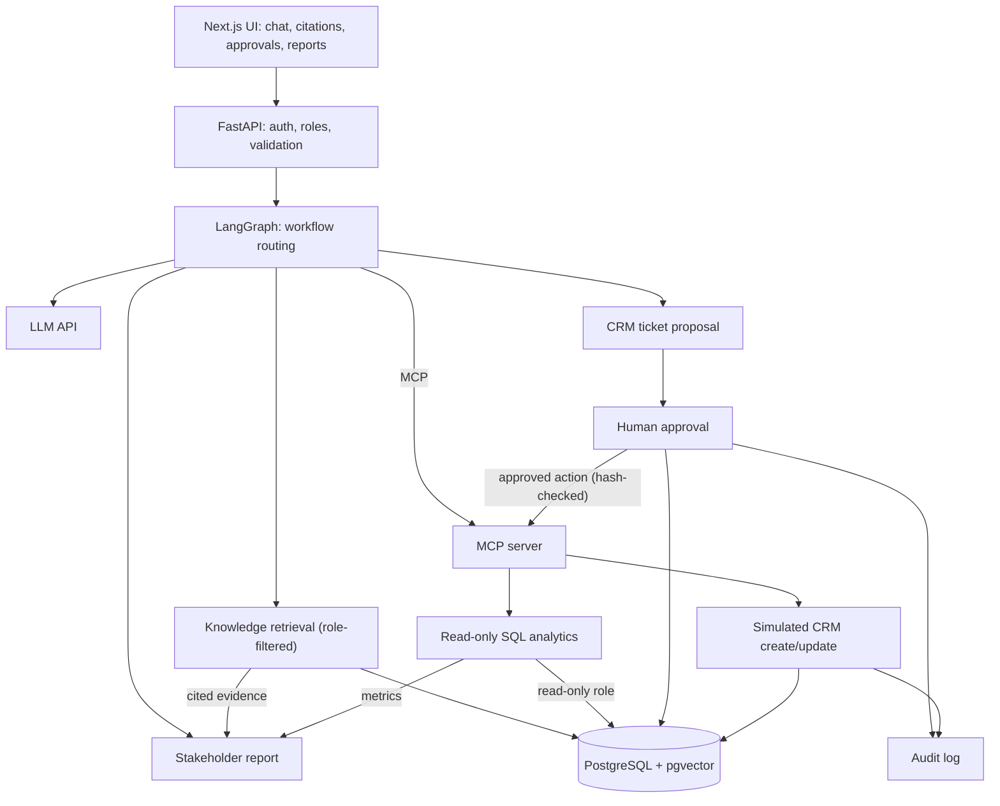

# Enterprise_AI_Operations_Pilot
A secure, permission-aware AI operations pilot for enterprise knowledge search, read-only analytics, and human-approved CRM actions.

## Architecture



Knowledge retrieval uses authorized documents, and analytics queries use approved read-only views. Ticket details are validated before approval; if they change afterward, the action requires reapproval. Approved payloads are hash-checked before execution. Requests, decisions, executions, and outcomes are recorded in the audit log.

## Project Structure

```text
frontend/            Minimal chat and approval interface
backend/             FastAPI API, LangGraph workflows, RAG, and approvals
backend/tests/       Backend unit and security tests
mcp_server/          Analytics and CRM MCP tools
mcp_server/tests/    MCP tool and safety tests
data/                Sample documents and analytics data
docs/                Architecture documentation
```
