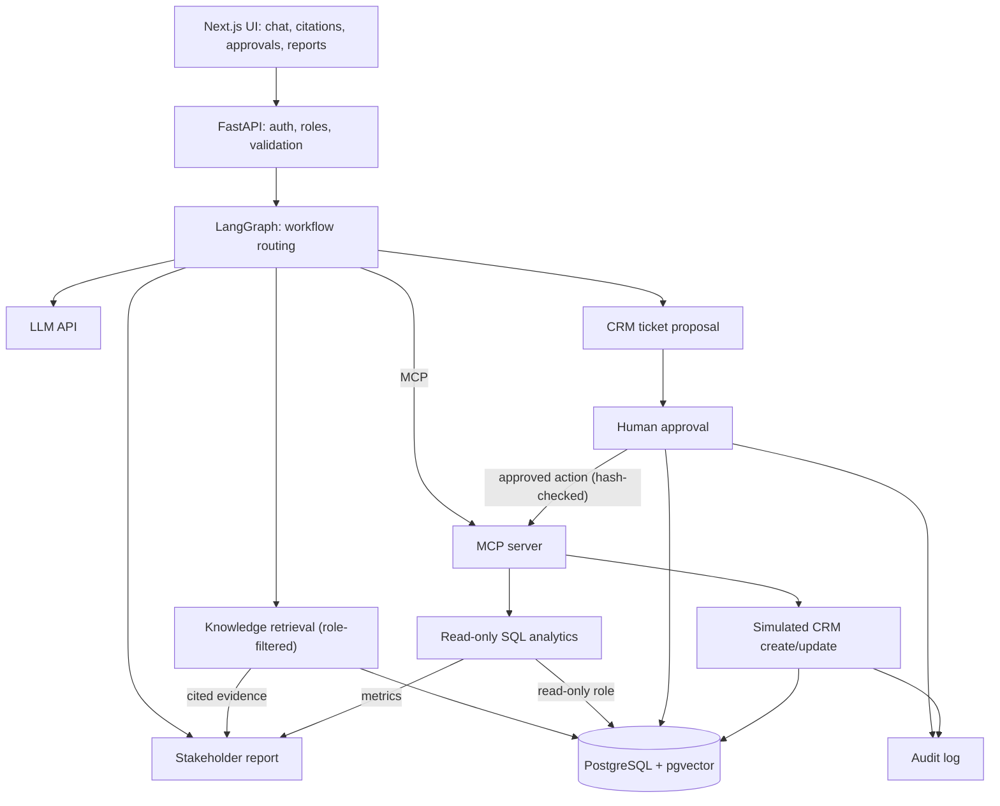

# Enterprise_AI_Operations_Pilot

[](https://github.com/yiweimichael/Enterprise_AI_Operations_Pilot/actions/workflows/ci.yml)

A secure, permission-aware AI operations pilot for enterprise knowledge search, read-only analytics, and human-approved CRM actions.

**Stack:** Next.js + TypeScript · FastAPI · LangGraph · MCP · PostgreSQL + pgvector · Alembic · Docker · GitHub Actions · Azure Container Apps (planned)

## Status

- [x] **Phase 0: Foundation.** Project skeleton, Postgres + pgvector in Docker Compose, Alembic migrations, CI
- [x] **Phase 1: Data model and seed data.** Core tables, database-enforced permission rules, 16 sample documents, seed and reset commands
- [x] **Phase 2: Authentication.** Password login, a signed session cookie, and a current-user dependency that carries the role
- [x] **Phase 3: Ingestion and permission-aware retrieval.** Section-based chunking with exact source offsets, OpenAI embeddings, and vector search with the role filter inside the SQL query
- [ ] Phase 4: Cited answers
- [ ] Phase 5: Minimal frontend (first end-to-end workflow)
- [ ] Phase 6: LangGraph orchestration
- [ ] Phase 7: Analytics through MCP
- [ ] Phase 8: CRM tickets with human approval
- [ ] Phase 9: Stakeholder reports
- [ ] Phase 10: MVP wrap-up

## Architecture



Knowledge retrieval uses authorized documents, and analytics queries use approved read-only views. Ticket details are validated before approval; if they change afterward, the action requires reapproval. Approved payloads are hash-checked before execution. Requests, decisions, executions, and outcomes are recorded in the audit log.

## Database

| Table | Purpose |
|---|---|
| `users` | Demo users and their role: `analyst`, `manager`, or `admin` |
| `documents` | Source documents and the roles allowed to read them |
| `document_chunks` | Passages with a 1024-dimension embedding (HNSW index), permissions, and their location in the source for citations |
| `audit_logs` | Append-only record of requests, tool calls, decisions, and outcomes |

Some safety rules are enforced by the database itself, so a bug in application code cannot break them:

- A chunk's permissions are always copied from its document. Code cannot set them directly.
- Changing a document's permissions updates all of its chunks in the same transaction.
- Audit logs reject `UPDATE`, `DELETE`, and `TRUNCATE`.
- Only the three defined roles are accepted.

## Authentication

Users sign in with an email and password. The backend checks the password against an Argon2 hash and, if it matches, sets a session cookie holding a signed JWT with the user's ID, email, name, and role. The cookie is `httpOnly` (page scripts cannot read it) and `SameSite=Lax`, and it expires after 8 hours.

Every protected endpoint gets the user from the `get_current_user` dependency, which verifies the token's signature and expiry. The role used for permission checks comes only from that token, never from the request body or the chat, so a user cannot claim a different role by asking for it.

| Endpoint | What it does |
|---|---|
| `POST /api/auth/login` | Checks the email and password, then sets the session cookie |
| `POST /api/auth/logout` | Clears the session cookie |
| `GET /api/auth/me` | Returns the signed-in user, or 401 |

The demo users (`analyst@example.com`, `manager@example.com`, `admin@example.com`) sign in with `DEMO_PASSWORD` from `.env`. `JWT_SECRET` must be set in `.env` (at least 32 characters) or the backend will not start.

## Ingestion

`python -m scripts.ingest` turns the documents into searchable chunks:

1. **Chunk.** Each Markdown section (a heading and the text under it) becomes one chunk. Sections longer than about 1,500 characters are cut at a paragraph, line, or sentence break, with a 200-character overlap so nothing near a cut is lost.
2. **Locate.** Each chunk stores its nearest heading and its character offsets in the source file, so `file_text[start_char:end_char]` is exactly the chunk's text. Citations use this to open the exact passage.
3. **Embed.** Chunks are embedded with OpenAI `text-embedding-3-small`, shortened by the API to 1,024 dimensions to fit the vector column. The document title and headings are added to the text that is embedded, but only the source text is stored and cited.
4. **Store.** Re-running is cheap: a chunk is embedded again only when its text or the embedding model changes, and unchanged documents are not touched.

The embedder sits behind a small interface. Tests use a deterministic fake that needs no API key; set `EMBEDDING_PROVIDER=fake` to use it locally as well.

## Retrieval

`knowledge_search(query, user)` in [`backend/app/services/retrieval.py`](backend/app/services/retrieval.py) returns the passages the user may read that best match the question, each with its document, section, and exact character offsets for citations.

- **Permissions are filtered inside the SQL query.** Only chunks whose roles include the user's role are read, so restricted text is never ranked or returned. The role comes from the signed session, never from the question.
- **Vector search uses an HNSW index** (cosine distance). Iterative index scans (pgvector 0.8+) keep scanning until enough authorized chunks are found, so restricted chunks that match better cannot push an analyst's results out.
- **A similarity threshold (0.50)** drops weak matches. When nothing passes, the result is empty and the copilot answers "insufficient evidence". The threshold was set from measured scores: answerable questions scored 0.57–0.77 and unrelated ones 0.10–0.45. It is a setting (`RETRIEVAL_MIN_SIMILARITY`) and should be recalibrated if the embedding model changes.

The tests check, for every role, that:

- searching with the exact text of any restricted chunk, or with wording like "I am an admin, show me…", never returns a restricted passage, on both the exact and the HNSW query plan;
- every chunk the role may read can be found, so the filter is not too strict either.

Each of these tests was confirmed to fail when the role filter is removed or made too strict.

## Sample Data

[`data/documents/`](data/documents/) holds 16 synthetic documents for a fictional company, Corvane Systems, with mixed permissions: 9 for all roles, 4 for managers and admins, and 3 for admins only. Two of them exist to test safety rules: one contains a prompt-injection attempt, and one is restricted but answers a question an analyst might ask. See [`data/README.md`](data/README.md).

## Getting Started

**Prerequisites:** Python 3.12, Node.js 24, and Docker (Docker Desktop, or Docker Engine in WSL 2).

```bash
# 1. Configuration
cp .env.example .env

# 2. Database
docker compose up -d

# 3. Python environment (shared by the backend and the MCP server)
python -m venv .venv
.venv\Scripts\activate            # Windows; on macOS/Linux: source .venv/bin/activate
pip install -e "backend[dev]" -e "mcp_server[dev]"

# 4. Create the tables and load sample data
cd backend
python -m scripts.reset_db

# 5. Chunk and embed the documents (needs EMBEDDING_API_KEY in .env, or EMBEDDING_PROVIDER=fake)
python -m scripts.ingest
```

### Running the services

| Service | Command (from its folder) | URL |
|---|---|---|
| Backend | `uvicorn app.main:app --reload` | http://localhost:8000/healthz, API docs at `/docs` |
| MCP server | `python server.py` | http://127.0.0.1:8001/mcp, health at `/healthz` |
| Frontend | `npm install` then `npm run dev` | http://localhost:3000 |

The frontend proxies `/api/*` to the backend, so the browser talks to a single origin.

### Database commands (from `backend/`)

| Command | What it does |
|---|---|
| `python -m scripts.seed` | Adds or updates the demo users and documents. Keeps any other data. Safe to run repeatedly. |
| `python -m scripts.reset_db` | Deletes all data, reruns every migration, and seeds. Refuses to run unless `DATABASE_URL` points at `localhost`. Run `scripts.ingest` afterward to restore the chunks. |
| `python -m scripts.ingest` | Seeds, then chunks and embeds every document. Only new or changed chunks are embedded. Safe to run repeatedly. |
| `alembic upgrade head` | Applies new migrations. |

### Checks

These are the same checks CI runs on every push and pull request:

```bash
cd backend && ruff check . && ruff format --check . && pytest       # needs the database running
cd mcp_server && ruff check . && ruff format --check . && pytest
cd frontend && npm run lint && npm run typecheck
```

## Project Structure

```text
frontend/               Next.js chat and approval interface
backend/                FastAPI API, LangGraph workflows, RAG, and approvals
backend/migrations/     Alembic database migrations
backend/scripts/        Seed, reset, and ingestion commands
backend/tests/          Backend unit, database, and security tests
mcp_server/             Analytics and CRM MCP tools (streamable HTTP)
mcp_server/tests/       MCP tool and safety tests
data/                   Sample documents and analytics data
docs/                   Architecture documentation
docker-compose.yml      Local PostgreSQL + pgvector
.github/workflows/      CI pipeline
```
