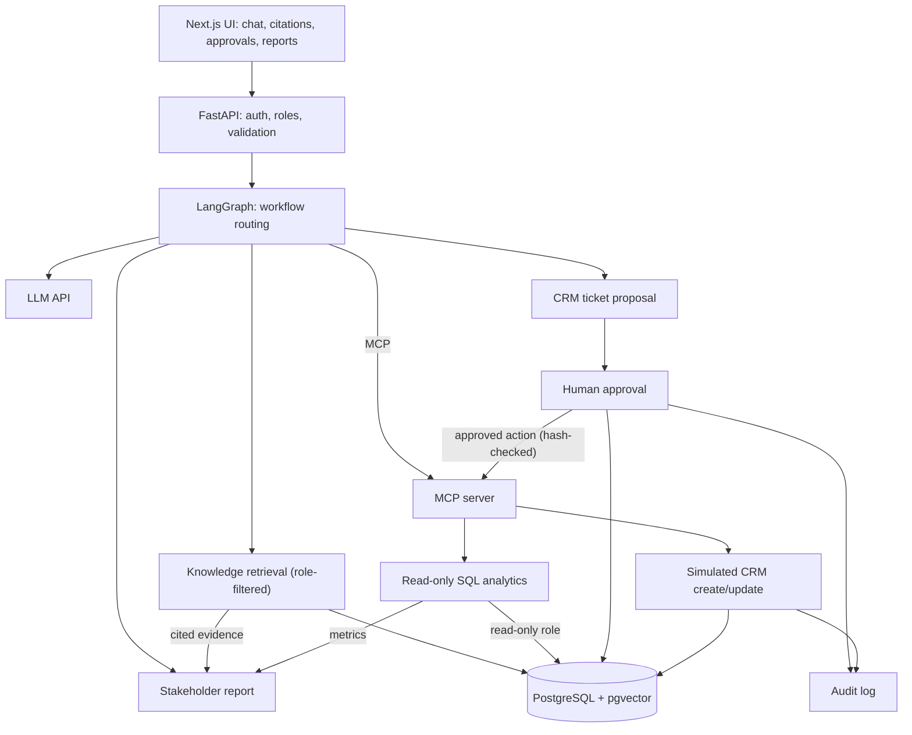

# Enterprise_AI_Operations_Pilot

[](https://github.com/yiweimichael/Enterprise_AI_Operations_Pilot/actions/workflows/ci.yml)

A secure, permission-aware AI operations pilot for enterprise knowledge search, read-only analytics, and human-approved CRM actions.

**Stack:** Next.js + TypeScript · FastAPI · LangGraph · MCP · PostgreSQL + pgvector · Alembic · Docker · GitHub Actions · Azure Container Apps (planned)

## Status

- [x] **Phase 0: Foundation.** Project skeleton, Postgres + pgvector in Docker Compose, Alembic migrations, CI
- [x] **Phase 1: Data model and seed data.** Core tables, database-enforced permission rules, 16 sample documents, seed and reset commands
- [ ] Phase 2: Authentication
- [ ] Phase 3: Ingestion and permission-aware retrieval
- [ ] Phase 4: Cited answers
- [ ] Phase 5: Minimal frontend (first end-to-end workflow)
- [ ] Phase 6: LangGraph orchestration
- [ ] Phase 7: Analytics through MCP
- [ ] Phase 8: CRM tickets with human approval
- [ ] Phase 9: Stakeholder reports
- [ ] Phase 10: MVP wrap-up

## Architecture



Knowledge retrieval uses authorized documents, and analytics queries use approved read-only views. Ticket details are validated before approval; if they change afterward, the action requires reapproval. Approved payloads are hash-checked before execution. Requests, decisions, executions, and outcomes are recorded in the audit log.

## Database

| Table | Purpose |
|---|---|
| `users` | Demo users and their role: `analyst`, `manager`, or `admin` |
| `documents` | Source documents and the roles allowed to read them |
| `document_chunks` | Passages with a 1024-dimension embedding (HNSW index), permissions, and their location in the source for citations |
| `audit_logs` | Append-only record of requests, tool calls, decisions, and outcomes |

Some safety rules are enforced by the database itself, so a bug in application code cannot break them:

- A chunk's permissions are always copied from its document. Code cannot set them directly.
- Changing a document's permissions updates all of its chunks in the same transaction.
- Audit logs reject `UPDATE`, `DELETE`, and `TRUNCATE`.
- Only the three defined roles are accepted.

## Sample Data

[`data/documents/`](data/documents/) holds 16 synthetic documents for a fictional company, Corvane Systems, with mixed permissions: 9 for all roles, 4 for managers and admins, and 3 for admins only. Two of them exist to test safety rules: one contains a prompt-injection attempt, and one is restricted but answers a question an analyst might ask. See [`data/README.md`](data/README.md).

## Getting Started

**Prerequisites:** Python 3.12, Node.js 24, and Docker (Docker Desktop, or Docker Engine in WSL 2).

```bash
# 1. Configuration
cp .env.example .env

# 2. Database
docker compose up -d

# 3. Python environment (shared by the backend and the MCP server)
python -m venv .venv
.venv\Scripts\activate            # Windows; on macOS/Linux: source .venv/bin/activate
pip install -e "backend[dev]" -e "mcp_server[dev]"

# 4. Create the tables and load sample data
cd backend
python -m scripts.reset_db
```

### Running the services

| Service | Command (from its folder) | URL |
|---|---|---|
| Backend | `uvicorn app.main:app --reload` | http://localhost:8000/healthz, API docs at `/docs` |
| MCP server | `python server.py` | http://127.0.0.1:8001/mcp, health at `/healthz` |
| Frontend | `npm install` then `npm run dev` | http://localhost:3000 |

The frontend proxies `/api/*` to the backend, so the browser talks to a single origin.

### Database commands (from `backend/`)

| Command | What it does |
|---|---|
| `python -m scripts.seed` | Adds or updates the demo users and documents. Keeps any other data. Safe to run repeatedly. |
| `python -m scripts.reset_db` | Deletes all data, reruns every migration, and seeds. Refuses to run unless `DATABASE_URL` points at `localhost`. |
| `alembic upgrade head` | Applies new migrations. |

### Checks

These are the same checks CI runs on every push and pull request:

```bash
cd backend && ruff check . && ruff format --check . && pytest       # needs the database running
cd mcp_server && ruff check . && ruff format --check . && pytest
cd frontend && npm run lint && npm run typecheck
```

## Project Structure

```text
frontend/               Next.js chat and approval interface
backend/                FastAPI API, LangGraph workflows, RAG, and approvals
backend/migrations/     Alembic database migrations
backend/scripts/        Seed and reset commands
backend/tests/          Backend unit, database, and security tests
mcp_server/             Analytics and CRM MCP tools (streamable HTTP)
mcp_server/tests/       MCP tool and safety tests
data/                   Sample documents and analytics data
docs/                   Architecture documentation
docker-compose.yml      Local PostgreSQL + pgvector
.github/workflows/      CI pipeline
```
